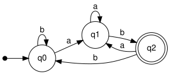

# automata-extensions

Extension **par héritage et mixins** de la bibliothèque Python
[`automata-lib`](https://pypi.org/project/automata-lib/) (version **9.2.0**), sans jamais en modifier le code.
Projet pédagogique L2 Informatique : « Langages, Automates, Grammaires et Extensions Python ».

## Objectifs

Ajouter à `automata-lib` les algorithmes classiques de la théorie des automates : analyse (accessibilité,
cycles, langage vide/infini), relations entre langages (inclusion, égalité, isomorphisme), minimisation et
classes de Myhill-Nerode, opérations sur les langages, expressions rationnelles (dérivées de Brzozowski,
Thompson, Arden), grammaires régulières, morphismes et monoïde syntaxique, exports Graphviz.

Règles respectées : automates **immuables** (aucune méthode ne modifie `self`, chaque transformation renvoie
un nouvel automate), `frozenset` pour les ensembles résultats, annotations de types, docstrings,
aucune modification (ni *monkey patching*) de `automata-lib`.

## Installation

```bash
python -m pip install -e .          # installe aussi automata-lib==9.2.0
python -m pip install -e ".[dev]"   # + pytest
```

Dépendances : Python ≥ 3.9, `automata-lib==9.2.0`. Pour `svg()` / `pdf()` : Graphviz (programme `dot`) ;
`dot()` et `latex_tikz()` sont en Python pur (la compilation du TikZ demande `pdflatex`, facultatif). Sous Windows : `winget install Graphviz.Graphviz`.

## Tests

```bash
python -m pytest            # toute la suite (racine du projet)
python -m pytest tests/test_audit.py -v
```

Les tests comparent les algorithmes à des **oracles indépendants** (simulateurs écrits à part, module `re` de
Python, Floyd-Warshall, énumération bornée de mots). Les tests marqués « native » comparent en plus avec les
méthodes natives d'`automata-lib` et sont ignorés (`skipped`) si la méthode native est absente.

## Architecture

```
automata_extensions/
├── fa/                       automates finis
│   ├── dfa.py                ExtendedDFA  (algorithmes propres au DFA)
│   ├── nfa.py                ExtendedNFA  (hooks NFA, trace par ensembles d'états)
│   ├── nerode.py             MyhillNerodePartition (fonction 59)
│   ├── morphism.py           AutomatonMorphism, MorphismError (fonction 61)
│   ├── monoid.py             TransitionMonoid, SyntacticMonoid (fonction 62)
│   └── mixins/
│       ├── analyse.py        AnalyseMixin        parcours, accessibilité, cycles, mots, traces
│       ├── conversions.py    ConversionMixin     déterminisation, ε, opérations de langages, regex
│       ├── grammaire.py      GrammaireMixin      automate → grammaire
│       ├── morphisme.py      MorphismeMixin      morphismes
│       └── visualisation.py  VisualisationMixin  dot / svg / pdf / tikz
├── regex/                    regex.py (AST, dérivées, Thompson), arden.py, equations.py, residual.py
└── grammar/                  grammar.py (grammaires régulières), tree.py (arbres de dérivation)
tests/                        test_dfa_algorithms.py, test_regex.py, test_grammar.py, test_arden.py,
                              test_equations.py, test_nerode.py, test_residual.py, test_morphism.py,
                              test_monoid.py, test_audit.py
docs/                         CONFORMITE.md (tableau des 62 fonctionnalités), images/
```

Héritage : `ExtendedDFA(VisualisationMixin, GrammaireMixin, MorphismeMixin, ConversionMixin, AnalyseMixin, DFA)`
et `ExtendedNFA(...)` avec les mêmes mixins : un algorithme qui ne dépend que de `states`, `transitions`,
`initial_state`, `final_states` est écrit **une seule fois** dans un mixin. Les noms des méthodes natives
(`complement`, `reverse`, `union`, `intersection`, ...) ne sont jamais réutilisés : d'où `complemented`,
`reversed_automaton`, `language_union`, `language_intersection`, etc.

## Fonctionnalités

Les 62 fonctionnalités du cahier des charges et leur statut vérifié sont dans
[`docs/CONFORMITE.md`](docs/CONFORMITE.md). Résumé : parcours (DFS/BFS), accessibilité, émondage, composantes
fortement connexes, cycles, langage vide/infini/universel, reconnaissance et trace, sous-automate induit,
complétion, complément, produit, inclusion/égalité/isomorphisme, préfixe-clos, états distinguables,
Myhill-Nerode, minimisation, ε-fermeture, déterminisation, ε-suppression, élimination d'états, exports DOT/SVG/
PDF/TikZ, union/intersection/différence/concaténation/étoile, quotients, dérivées de Brzozowski, Thompson,
NFA→DFA, DFA→regex (élimination, Arden), grammaires et arbres de dérivation, lemme d'Arden, systèmes
d'équations, automate résiduel, morphismes, monoïde syntaxique.

## Exemples d'utilisation

Ces exemples ont été exécutés ; les sorties indiquées sont les sorties réelles.

```python
from automata_extensions.fa import ExtendedDFA

dfa = ExtendedDFA(
    states={"q0", "q1", "q2", "q3"}, input_symbols={"a", "b"},
    transitions={"q0": {"a": "q1", "b": "q0"}, "q1": {"a": "q1", "b": "q2"},
                 "q2": {"a": "q1", "b": "q0"}, "q3": {"a": "q3", "b": "q3"}},
    initial_state="q0", final_states={"q2"}, allow_partial=True,   # langage : mots finissant par ab
)
dfa.accessible_states()          # frozenset({'q0', 'q1', 'q2'})   (q3 est inaccessible)
dfa.is_trim()                    # False
dfa.trim().states                # frozenset({'q0', 'q1', 'q2'})
dfa.accepts("aab")               # True
dfa.execution_trace("aab").configurations   # ('q0', 'q1', 'q1', 'q2')
dfa.complemented().accepts("aab")           # False
dfa.has_same_language_as(dfa.minimize())    # True
dfa.to_regex_elimination()       # 'b*aa*b((bb*a|a)a*b)*'
dfa.is_empty(), dfa.is_infinite()           # (False, True)
print(dfa.to_right_grammar())    # S → aA0 | bS ; A0 → aA0 | bA1 ; A1 → ε | aA0 | bS ; A2 → aA2 | bA2
dfa.trim().svg("dfa.svg")        # nécessite Graphviz (dfa.dot() n'en a pas besoin)
```

Schéma produit par `dfa.trim().svg()` : 

```python
from automata_extensions.regex import Regex, solve_arden

r = Regex.parse("(a|b)*ab")
r.derivative("a")                # (a|b)*ab|b
r.to_nfa()                       # ExtendedNFA (construction de Thompson, 12 états)
r.brzozowski_dfa()               # ExtendedDFA des dérivées (3 états) : docs/images/regex_brzozowski.svg
solve_arden(Regex.parse("a"), Regex.parse("b"))   # a*b   (solution de X = aX ∪ b)

sm = dfa.syntactic_monoid()      # quotient du monoïde de transition par la congruence syntaxique
len(sm), [e.word for e in sm]    # (5, ['', 'a', 'b', 'ab', 'bb'])
h = dfa.minimization_morphism()  # morphisme strict, non injectif, vers l'automate minimal
print(dfa.nerode_partition())    # classes de Myhill-Nerode (mots représentants les plus courts)
```

Syntaxe des expressions : `|` union, `*` étoile, juxtaposition = concaténation, `ε` mot vide, `∅` langage vide,
`\x` pour un symbole spécial. Ce n'est **pas** la syntaxe `re` de Python.

## Algorithmes et complexité (résumé)

| Algorithme | Idée | Complexité (pire cas) |
|---|---|---|
| DFS / BFS / accessibles / coaccessibles | pile / file, graphe renversé | O(\|Q\| + \|E\|) |
| Composantes fortement connexes | Kosaraju | O(\|Q\| + \|E\|) |
| Complétion, complément | état puits, échange des finals | O(\|Q\|·\|Σ\|) |
| Produit cartésien (lazy) | couples accessibles | O(\|Q₁\|·\|Q₂\|·\|Σ\|) |
| Inclusion / égalité | vide du produit | O(\|Q₁\|·\|Q₂\|·\|Σ\|) |
| Classes de Nerode, minimisation | raffinement de Moore | O(\|Q\|²·\|Σ\|) |
| Déterminisation | sous-ensembles accessibles | O(2^\|Q\|·\|Σ\|) |
| Dérivées / automate de Brzozowski | dérivées en forme normale | dépend de l'expression (limite `max_states`) |
| Thompson | un fragment par opérateur | O(\|r\|) états |
| DFA → regex (élimination) | suppression d'états | O(\|Q\|³) opérations, taille de l'expression exponentielle possible |
| Monoïde syntaxique | fermeture des générateurs sur les classes de Nerode | ≤ k^k éléments (k = nombre de classes) |

Chaque méthode donne sa complexité et ses conventions dans sa docstring.

## Limites connues

- Les algorithmes des fonctions 19 à 32 sont définis pour `ExtendedDFA` ; un NFA passe par `to_dfa()`.
- Pas de `ExtendedGNFA`, de PDA ni de machine de Turing (hors des 62 fonctionnalités).
- La fonction 50 est implémentée comme **automate des dérivées** de Brzozowski. Composer deux fois
  `reversed_automaton().determinize()` conserve le langage mais n'est pas toujours minimal (un état en trop au plus).
- Les noms de méthodes diffèrent de ceux d'`automata-lib` pour ne pas les masquer.
- La suite a été exécutée avec une bibliothèque `automata` de substitution (pas avec `automata-lib` 9.2.0 réelle) ;
  lancez `python -m pytest` après l'installation pour exécuter les tests « native ».
